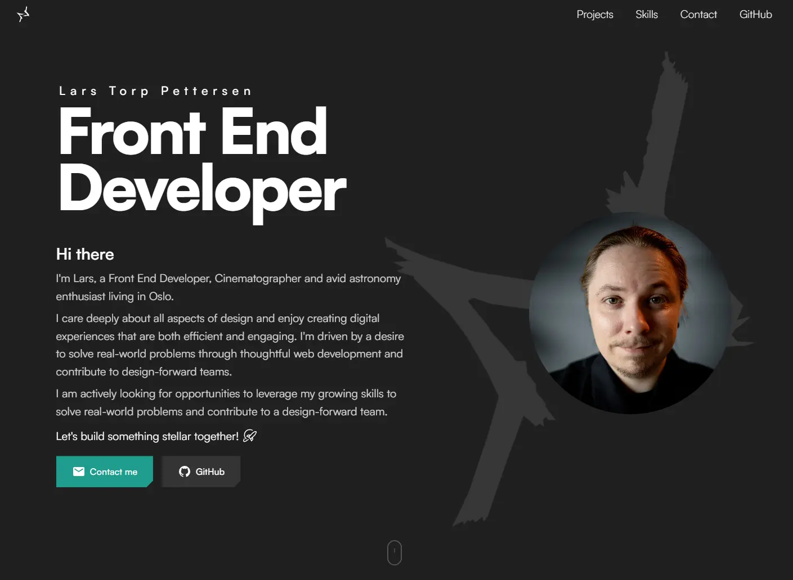

# Lars Torp Pettersen | Portfolio

<p align="center">
  
</p>

This is my personal portfolio as a front-end developer based in Oslo, with a background in cinematography and a strong interest in design.

Feel free to explore the code, copy ideas, or adapt parts of the project for your own work. The site presents projects through a responsive React experience with dedicated project articles, interactive media, and JSON-backed content.

## Live Site

[larstp.com](https://larstp.com)

## Built With

- React 19 and TypeScript
- Vite
- React Router
- Motion
- Plain CSS and CSS Modules
- JSON-backed project data
- Vercel Analytics and Web3Forms
- Vercel deployment

## Highlights

- Responsive, mobile-first layout
- DecoderText animations for Hero, Article, and section headings
- Pixelated interactive portrait effect
- Animated background treatment
- Project cards with technology metadata and separate live/repository actions
- JSON-driven Article pages with image carousels
- Configurable fitted or cover-style carousel images
- Accessible navigation, forms, labels, focus states, and reduced-motion behavior
- SEO metadata, sitemap, robots file, manifest, and favicon

## Getting Started

```bash
npm install
npm run dev
```

The development server prints the local URL in the terminal.

### Environment Variables

The contact form uses Web3Forms. Create `.env.local` in the repository root:

```env
VITE_WEB3FORMS_ACCESS_KEY=your_web3forms_access_key
```

The same variable must be configured in the Vercel project for deployed form submissions.

## Project Data

Project content lives in:

```text
src/data/projects.json
src/data/technologies.json
```

Home projects must use both of these values:

```json
"featured": true,
"status": "active"
```

The project order is controlled through `settings.projectOrder`.

### Add a Project

Interactive workflow:

```bash
npm run add-project
```

Validation:

```bash
npm run validate-data
```

The generator supports project cards, Article content, carousel images, fitted-image settings, archived projects, and project ordering. It prints a confirmation summary and validates the data before keeping changes.

The full workflow and reusable template are documented here:

- [Add-project guide](documentation/add-project-howto.md)
- [Project template](documentation/project-template.json)

## Validation

```bash
npm run typecheck
npm run lint
npm run build
```

Preview a production build with:

```bash
npm run preview
```

## Deployment

The project is configured for Vercel through [vercel.json](vercel.json). The configuration builds `dist` and rewrites application routes for the React Router SPA.

Public SEO files include:

- `/robots.txt`
- `/sitemap.xml`
- `/icons/favicon/site.webmanifest`

<details>
  <summary>Project structure</summary>

```text
src/
├── components/       Reusable UI components and CSS Modules
├── data/             Projects, technologies, and skills
├── hooks/            Shared React hooks
├── layouts/          Site-wide layout and navigation
├── lib/              Constants and external services
├── pages/            Home and Article routes
├── utils/             Shared browser utilities
├── App.tsx
├── main.css
└── main.tsx

public/
├── fonts/
├── icons/
└── images/projects/

tools/
├── add-project.mjs
└── validate-projects.mjs
```

</details>

<details>
  <summary>Accessibility and performance</summary>

The interface uses semantic landmarks and headings, accessible form labels, visible focus states, meaningful image alternatives, keyboard-friendly controls, responsive layouts, lazy-loaded project images, and reduced-motion handling.

</details>

## Inspiration and Credits

The visual direction draws from personal design work and public portfolio references. External assets and open-source resources are used with appropriate attribution and licensing.
